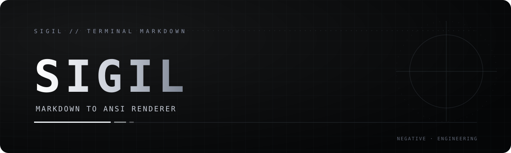

<div align="center">



# Sigil

**Zero-dependency Markdown → ANSI terminal renderer for a documented CommonMark subset.**

<p>
  
  
  
  
  
</p>

</div>

> Sigil (formerly `glyphmd`) turns a README into readable terminal output:
> headings, lists, quotes, fenced code and inline styles, with no crates and no
> regex engine.

## What it is

Sigil is a small Markdown renderer that emits ANSI escape sequences. It parses a
delimited subset into blocks (`parse_blocks`) and renders them to any `Write`
(`render`), using a fixed palette rather than theme detection. It is meant for
reading project documentation in a terminal, not for converting arbitrary
CommonMark to HTML.

The crate and binary keep their original name, `sifr-md`; the product name is
Sigil and the repository is still `Sifr-Dev/glyphmd`.

## Current capabilities

- **Block parsing** — `#`–`####` headings, `---` horizontal rules, paragraphs,
  `-`/`*` unordered lists, `1.` ordered lists, fenced code blocks (verbatim),
  and `>` blockquotes (`parse_blocks`, `src/main.rs`; unit tests
  `parses_headings_and_hr`, `parses_code_fence_verbatim`, `list_items_collected`,
  `paragraph_soft_wraps`).
- **Inline styling** — `**bold**`, `*italic*`, `` `code` ``, `~~strike~~`,
  `[text](url)` rendered underlined with a dim URL (`inline`, `src/main.rs`;
  tests `inline_styles`, `inline_link`).
- **UTF-8 safe** — multibyte characters are copied whole, never split; invalid
  UTF-8 is replaced lossily instead of panicking (`inline`, `read_lossy`; tests
  `multibyte_utf8_survives_inline`, `invalid_utf8_is_lossily_replaced`).
- **Backslash escapes** — `\` consumes the next whole character, including
  multibyte, and a trailing lone backslash is kept verbatim (`inline`; tests
  `escape_before_multibyte_char_emits_it_literally`,
  `escape_suppresses_markdown_syntax`, `trailing_backslash_is_literal`).
- **Robust on arbitrary input** — the inline scanner is asserted never to panic
  on arbitrary char boundaries (`inline_never_panics_on_arbitrary_char_boundaries`).
- **Input selection** — file argument, `-` or no argument for stdin (`main`);
  `--help`/`--version`; extra arguments exit 2 with usage.
- **Correct stream behaviour** — a broken pipe exits quietly, other stdout write
  failures report and exit 2 (`main`; CLI tests in `tests/cli.rs`).
- **25 tests** (14 unit, 11 CLI) plus `rustfmt`, `clippy -D warnings` and
  `cargo doc -D warnings` in CI.

## Quick start

```sh
git clone https://github.com/Sifr-Dev/glyphmd.git
cd glyphmd
cargo build --release
./target/release/sifr-md README.md
cat README.md | ./target/release/sifr-md
```

## Verification

```sh
cargo fmt --all -- --check
cargo clippy --locked --all-targets -- -D warnings
cargo test --locked --all-targets              # 14 + 11
cargo test --locked --release --all-targets    # 14 + 11
RUSTDOCFLAGS="-D warnings" cargo doc --locked --no-deps
```

Observed on this machine (2026-11-28; Rust 1.100.0, AMD Ryzen 7 7435HS,
Linux 7.3.4):

```text
running 14 tests   (unit)   ... 14 passed; 0 failed
running 11 tests   (cli)    ... 11 passed; 0 failed
```

CI (`.github/workflows/ci.yml`) runs the same five commands on every push to
`main` and every pull request.

## Architecture

| Path | Responsibility |
|---|---|
| `src/main.rs` | ANSI constants, block parser, inline scanner, renderer, CLI, unit tests |
| `tests/cli.rs` | Process-level tests: stdin, files, `--help`, `--version`, bad arguments, broken pipe |
| `Cargo.toml` | Crate `sifr-md` 0.1.0, no dependencies |

Parsing produces `Vec<Block>`; rendering walks the blocks and writes once per
line. There is no AST for inline content — `inline` is a recursive scanner that
emits escape sequences directly.

## Limitations

- Deliberately not CommonMark: no nested lists, tables, images, raw HTML,
  footnotes, setext headings, link references, or autolinks.
- Inline code and fenced code are not syntax-highlighted; fences are printed
  verbatim with the code colour.
- Paragraph wrapping is soft (source newlines are preserved as spaces); there is
  no width-aware reflow.
- The palette is fixed and assumes a dark terminal; there is no light mode or
  `NO_COLOR` support.
- The whole input is read into memory before rendering.
- Inline emphasis is not CommonMark's delimiter algorithm: `**bold**` and
  `*italic*` match the first closing delimiter, so pathological nesting can
  render differently from a spec-compliant parser.

## Roadmap (NOT IMPLEMENTED)

- `NO_COLOR` / `--plain` output.
- Width-aware paragraph reflow.
- Syntax highlighting for fenced code.
- Nested lists and blockquote nesting.
- Table rendering.
- Binary rename to `sigil` while keeping `sifr-md` working.

## License

MIT. See [LICENSE](LICENSE).
